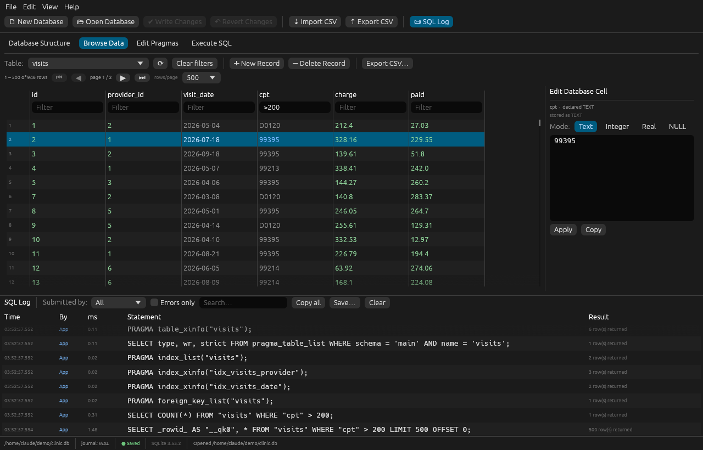

# Quarry — a DB Browser for SQLite–style workbench in Rust

A native desktop tool for creating, designing, browsing and editing SQLite
databases, modelled on DB Browser for SQLite (DB4S). Single binary, SQLite
compiled in — no JDBC drivers, no connection strings, no runtime to install.



## Features

**Database Structure** — tree of tables, views, indices and triggers. For each
table: columns (type, PK, NOT NULL, default, generated), indices (with column
order and DESC), foreign keys, STRICT / WITHOUT ROWID flags, and the highlighted
`CREATE` statement. Create Table and Create Index designers generate the SQL live
as you click; Drop asks for confirmation and stays revertible.

**Browse Data** — paged grid (100–5000 rows/page) with per-column filters
(`text` → `LIKE`, `>5`, `<=3`, `<>0`, `=NULL`), click-to-sort headers, and an
*Edit Database Cell* dock (Text / Integer / Real / NULL). Rows are addressed by
rowid, or by primary key for WITHOUT ROWID tables; views are read-only.

**Execute SQL** — highlighted editor, *Execute all* (Ctrl+Enter / F5) and
*Execute current* (Shift+F5, statement under the cursor or the selection),
per-statement messages and timing, result grid, results → CSV, open/save `.sql`.
Scripts are split with SQLite's own `sqlite3_complete()`, so semicolons inside
strings, comments and trigger bodies are handled correctly.

**Edit Pragmas** — typed editors for 22 pragmas (journal_mode, synchronous,
foreign_keys, auto_vacuum, wal_autocheckpoint, cache_size, page_size,
busy_timeout, mmap_size, user_version …). A dedicated **Write-Ahead Logging**
panel shows the current mode, `-wal`/`-shm` file sizes, one-click WAL ↔ DELETE
switching, and PASSIVE / FULL / RESTART / TRUNCATE checkpoints with their
busy/frames/checkpointed result. Maintenance: integrity check, quick check,
foreign-key check, optimize, analyze, vacuum.

**SQL Log** — every raw statement executed behind a UI action, tagged
**App** or **User**, with timing and rows affected. Bound parameters are
shown inline (via `sqlite3_expanded_sql`), so you see exactly what ran.
Filter by submitter, errors only, or text; copy, save, or double-click a
statement to send it to the editor.

**Write / Revert Changes** — UI edits run inside a `SAVEPOINT "RESTOREPOINT"`,
just like DB4S. Nothing touches disk until *Write Changes* (Ctrl+S); *Revert*
rolls everything back. Statements that can't run inside a transaction
(`VACUUM`, `PRAGMA journal_mode = …`, `ATTACH` …) are blocked with a clear
message while changes are pending, and you're prompted before closing.

**CSV import without type-casting failures**
- Delimiter auto-detected (`,` `;` tab `|`), BOM stripped, quoted multi-line
  fields, ragged rows padded, blank/duplicate headers made unique.
- Type detection scans *all* rows and is deliberately conservative: values
  only become INTEGER/REAL if they round-trip unchanged, so `02134`, `000123`,
  20-digit IDs, `1e400`, `NaN` and over-precise decimals stay TEXT.
- Values are bound with an explicit SQLite type chosen from the target
  column's affinity (SQLite's own rules), never by string casting.
- STRICT tables are validated cell by cell; you choose **abort**, **skip row**,
  or **store NULL**, and get a list of offending line/column pairs.
- Append to an existing table maps columns by header name (case-insensitive)
  or by position. The import runs in its own savepoint — an abort leaves the
  database untouched — and a success is still revertible.

**Export** — table or query result → CSV (separator, quote char, quote-all,
header, NULL text, LF/CRLF; reals at full precision, non-UTF-8 BLOBs as hex),
and whole database → `.sql` dump.

## Build & run

Requires Rust 1.85+ (edition 2024) and a C compiler for the bundled SQLite
(MSVC Build Tools on Windows, Xcode CLT on macOS, `build-essential` on Linux).

```bash
cargo run --release -- path/to/database.db   # path is optional
cargo test                                   # 13 tests: DB layer, CSV, SQL gen
```

Linux needs the usual X11/Wayland libraries; file dialogs use the XDG desktop
portal. If no portal is available, use **File → Open by Path…** and type paths
into the import/export dialogs.

## Shortcuts

| Keys | Action |
|---|---|
| Ctrl+O | Open database |
| Ctrl+S | Write changes |
| Ctrl+Enter / F5 | Execute all SQL |
| Shift+F5 | Execute current statement / selection |
| Ctrl+R | Refresh |
| Ctrl+L | Toggle SQL log |

## Layout

```
src/
  main.rs          window setup, CLI arg
  app.rs           menus, toolbar, tabs, status bar, pending-changes flow
  db.rs            rusqlite wrapper: logging, savepoints, schema, pragmas, WAL, dump
  csv_io.rs        CSV read/infer/convert/import/export
  ui/structure.rs  Database Structure tab
  ui/browse.rs     Browse Data tab + cell editor
  ui/execute.rs    Execute SQL tab
  ui/pragmas.rs    Edit Pragmas tab + WAL + maintenance
  ui/log.rs        SQL Log dock
  ui/dialogs.rs    Import, Export, Create Table, Create Index
  ui/widgets.rs    SQL highlighter, data grid
```

Built with [egui/eframe](https://github.com/emilk/egui) 0.37,
[rusqlite](https://github.com/rusqlite/rusqlite) 0.40 (SQLite 3.53 bundled),
[csv](https://github.com/BurntSushi/rust-csv) and [rfd](https://github.com/PolyMeilex/rfd).

## Not (yet) included vs DB4S

Modify Table (ALTER-by-rebuild designer), SQLCipher encryption, plotting dock,
remote/DBHub, attaching databases from the UI (works via Execute SQL), JSON
export, multiple SQL editor tabs, saved project files.
