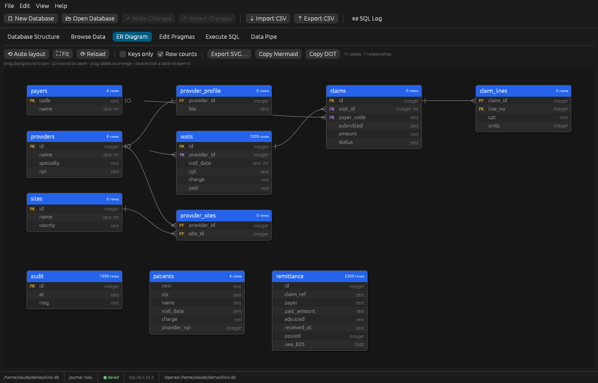
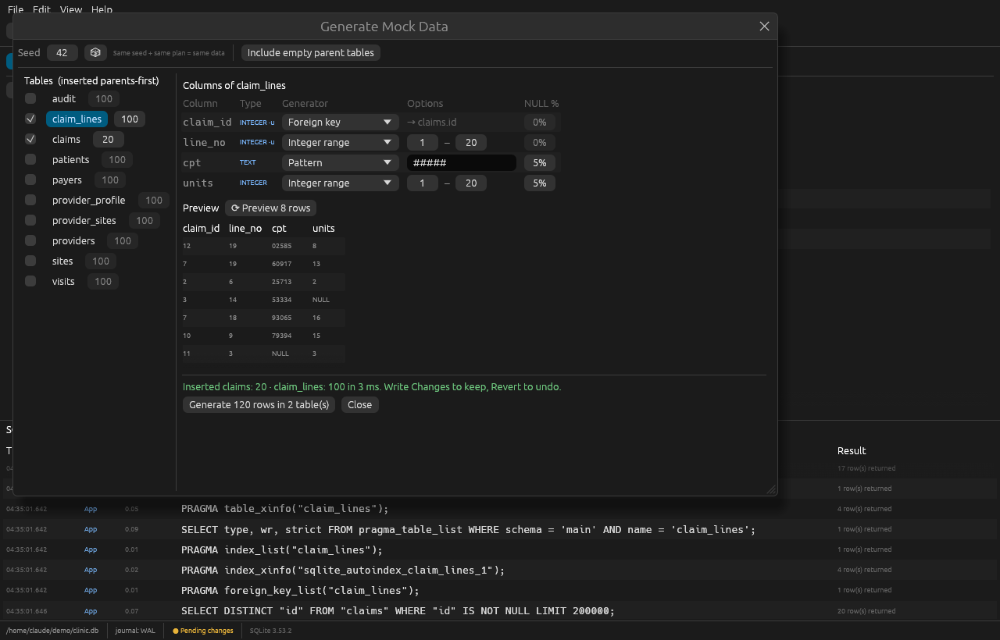
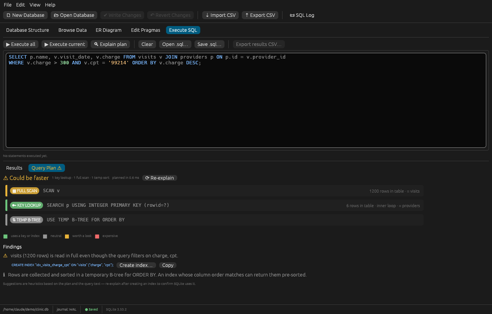
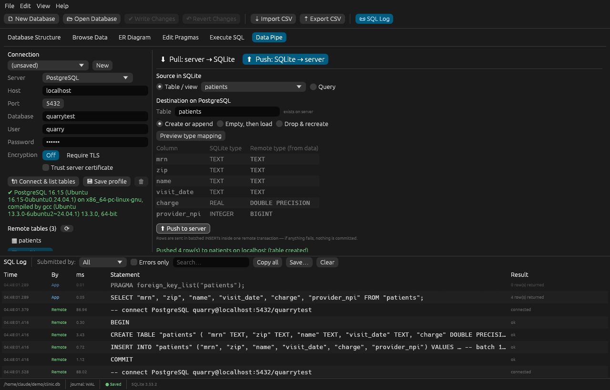

# Quarry — a DB Browser for SQLite–style workbench in Rust

A native desktop tool for creating, designing, browsing and editing SQLite
databases, modelled on DB Browser for SQLite (DB4S). Single binary, SQLite
compiled in — no JDBC drivers, no connection strings, no runtime to install.


## Features

**Database Structure** — tree of tables, views, indices and triggers. For each
table: columns (type, PK, NOT NULL, default, generated), indices (with column
order and DESC), foreign keys, STRICT / WITHOUT ROWID flags, and the highlighted
`CREATE` statement. Create Table and Create Index designers generate the SQL live
as you click; Drop asks for confirmation and stays revertible.

**Browse Data** — paged grid (100–5000 rows/page) with per-column filters
(`text` → `LIKE`, `>5`, `<=3`, `<>0`, `=NULL`), click-to-sort headers, and an
*Edit Database Cell* dock (Text / Integer / Real / NULL). Rows are addressed by
rowid, or by primary key for WITHOUT ROWID tables; views are read-only.

**Execute SQL** — highlighted editor, *Execute all* (Ctrl+Enter / F5) and
*Execute current* (Shift+F5, statement under the cursor or the selection),
per-statement messages and timing, result grid, results → CSV, open/save `.sql`.
Scripts are split with SQLite's own `sqlite3_complete()`, so semicolons inside
strings, comments and trigger bodies are handled correctly.

**Edit Pragmas** — typed editors for 22 pragmas (journal_mode, synchronous,
foreign_keys, auto_vacuum, wal_autocheckpoint, cache_size, page_size,
busy_timeout, mmap_size, user_version …). A dedicated **Write-Ahead Logging**
panel shows the current mode, `-wal`/`-shm` file sizes, one-click WAL ↔ DELETE
switching, and PASSIVE / FULL / RESTART / TRUNCATE checkpoints with their
busy/frames/checkpointed result. Maintenance: integrity check, quick check,
foreign-key check, optimize, analyze, vacuum.

**SQL Log** — every raw statement executed behind a UI action, tagged
**App** or **User**, with timing and rows affected. Bound parameters are
shown inline (via `sqlite3_expanded_sql`), so you see exactly what ran.
Filter by submitter, errors only, or text; copy, save, or double-click a
statement to send it to the editor.

**Write / Revert Changes** — UI edits run inside a `SAVEPOINT "RESTOREPOINT"`,
just like DB4S. Nothing touches disk until *Write Changes* (Ctrl+S); *Revert*
rolls everything back. Statements that can't run inside a transaction
(`VACUUM`, `PRAGMA journal_mode = …`, `ATTACH` …) are blocked with a clear
message while changes are pending, and you're prompted before closing.

**CSV import without type-casting failures**
- Delimiter auto-detected (`,` `;` tab `|`), BOM stripped, quoted multi-line
  fields, ragged rows padded, blank/duplicate headers made unique.
- Type detection scans *all* rows and is deliberately conservative: values
  only become INTEGER/REAL if they round-trip unchanged, so `02134`, `000123`,
  20-digit IDs, `1e400`, `NaN` and over-precise decimals stay TEXT.
- Values are bound with an explicit SQLite type chosen from the target
  column's affinity (SQLite's own rules), never by string casting.
- STRICT tables are validated cell by cell; you choose **abort**, **skip row**,
  or **store NULL**, and get a list of offending line/column pairs.
- Append to an existing table maps columns by header name (case-insensitive)
  or by position. The import runs in its own savepoint — an abort leaves the
  database untouched — and a success is still revertible.

**ER Diagram** — generated automatically from the foreign keys SQLite reports
(`PRAGMA foreign_key_list`), including composite and self-referencing keys.
Parents are laid out left of their children, ordered to reduce crossing lines;
unrelated tables are parked below. Crow's-foot notation: many vs. one (UNIQUE
FK → 1:1), dashed lines for optional (nullable) FKs, red for FKs pointing at a
missing table. Pan, zoom, drag tables, hover to highlight a table's
relationships, double-click to open it, "keys only" mode, live row counts.
Export to **SVG** (uses your current arrangement), or copy **Mermaid**
`erDiagram` (pastes into GitHub, GitLab, Notion, Confluence) or Graphviz **DOT**.



**Mock Data** — fill one table or a whole schema with realistic test rows.
- A generator is picked per column from its name, type, default and
  constraints: `email` → email, `first_name`, `phone`, `zip`, `dob`, `*_at`
  timestamps, money columns, `status` choices, `npi`/`mrn`/`code` patterns,
  booleans, UUIDs, lorem text… 28 generators, each tweakable (ranges, date
  spans, choice lists, `MRN######`-style patterns, NULL %).
- Foreign keys sample keys that really exist in the parent table; multi-table
  runs insert **parents first** (and "Include empty parent tables" ticks them
  for you), so referential integrity holds.
- UNIQUE / PRIMARY KEY groups — composite ones too — are enforced, seeded with
  the values already in the table.
- Values are typed for the column's affinity, so STRICT tables work.
- **Seeded**: the same seed and plan always produce the same data.
- Mock data can't collide with real people: emails use the reserved
  `example.com/.org/.net` domains, phones the fictional 555-01xx range,
  SSN-shaped patterns a `000` prefix.
- Everything lands in one savepoint — Revert removes it all.



**Visual query plan** — in Execute SQL press **🔍 Explain plan** (Ctrl+E) for
the statement under the cursor. Quarry runs `EXPLAIN QUERY PLAN`, draws the
plan as a colour-coded tree (key lookup / index search / covering scan /
index scan / full scan / automatic index / temp B-tree sort / subqueries), shows
each table's row count and which loops are nested, and gives a verdict.
Findings explain problems in plain language and propose concrete indexes:
- *automatic index* → SQLite tells us the columns; suggest a permanent one,
- full scan of a filtered table → index on the WHERE columns, equality
  columns first (`(cpt, charge)` for `cpt = ? AND charge > ?`),
- nested full scan in a join → index on the join column,
- temp B-tree for ORDER BY → index matching the sort,
- correlated subqueries → rewrite as JOIN.

One click opens Create Index pre-filled; re-explain to confirm SQLite uses it.



**Data Pipe** — move data between SQLite and **PostgreSQL**, **MySQL /
MariaDB** and **SQL Server / Azure SQL**, no ODBC/JDBC setup.
- *Pull* a remote table or any query (optional row limit) into a new, replaced
  or appended SQLite table. Values are read in their exact text form; SQLite
  types are inferred from the data, so a `numeric(30,10)` that doesn't fit a
  double stays exact TEXT, money becomes REAL, bool → INTEGER, bytea/varbinary
  → BLOB, uuid/timestamps → TEXT.
- *Push* a SQLite table or query to the server: *create or append*, *empty then
  load*, or *drop & recreate*. Remote column types are inferred from what's
  actually stored — SQLite lets an INTEGER column hold `'n/a'`; Quarry notices,
  widens that column to a text type and tells you, instead of failing on row
  40,000. *Preview type mapping* shows the plan first. Primary keys carry over.
- Rows go in batched multi-row INSERTs inside **one remote transaction** —
  all or nothing. Pulls land in a SQLite savepoint — revertible.
- Runs on a background thread with a progress bar; the UI stays responsive.
- Every statement sent to the server appears in the SQL Log tagged **Remote**.
- TLS (with optional "trust server certificate"), saved connection profiles —
  **passwords are never written to disk**.



**Export** — table or query result → CSV (separator, quote char, quote-all,
header, NULL text, LF/CRLF; reals at full precision, non-UTF-8 BLOBs as hex),
and whole database → `.sql` dump.

## Build & run

Requires Rust 1.85+ (edition 2024) and a C compiler for the bundled SQLite
(MSVC Build Tools on Windows, Xcode CLT on macOS, `build-essential` on Linux).

```bash
cargo run --release -- path/to/database.db   # path is optional
cargo test                                   # 32 tests
```

Server drivers are Cargo features (all on by default):

```bash
cargo build --release --no-default-features              # SQLite only
cargo build --release --no-default-features --features pg,mysql-driver
```

Live Data Pipe tests run against real servers when you point them at one
(format `host:port:database:user:password`):

```bash
QUARRY_TEST_PG=127.0.0.1:5432:test:me:secret \
QUARRY_TEST_MYSQL=127.0.0.1:3306:test:me:secret \
QUARRY_TEST_MSSQL=127.0.0.1:1433:test:sa:secret \
cargo test live
```

Each pushes a table full of awkward values (quotes, backslashes, Unicode,
BLOBs, a big int, text in an INTEGER column), pulls it back and compares.

Linux needs the usual X11/Wayland libraries; file dialogs use the XDG desktop
portal. If no portal is available, use **File → Open by Path…** and type paths
into the import/export dialogs.

## Shortcuts

| Keys | Action |
|---|---|
| Ctrl+O | Open database |
| Ctrl+S | Write changes |
| Ctrl+Enter / F5 | Execute all SQL |
| Shift+F5 | Execute current statement / selection |
| Ctrl+E | Explain query plan |
| Ctrl+R | Refresh |
| Ctrl+L | Toggle SQL log |

## Layout

```
src/
  main.rs          window setup, CLI arg
  app.rs           menus, toolbar, tabs, status bar, pending-changes flow
  db.rs            rusqlite wrapper: logging, savepoints, schema, pragmas, WAL, dump
  csv_io.rs        CSV read/infer/convert/import/export
  er.rs            ER model, auto layout, SVG / Mermaid / DOT export
  mock.rs          mock data generators, FK ordering, uniqueness
  plan.rs          EXPLAIN QUERY PLAN parsing, classification, index advice
  pipe/mod.rs      Data Pipe: jobs, type inference, push/pull, profiles
  pipe/pg.rs       PostgreSQL driver
  pipe/mysql.rs    MySQL / MariaDB driver
  pipe/mssql.rs    SQL Server driver
  ui/structure.rs  Database Structure tab
  ui/browse.rs     Browse Data tab + cell editor
  ui/execute.rs    Execute SQL tab
  ui/pragmas.rs    Edit Pragmas tab + WAL + maintenance
  ui/log.rs        SQL Log dock
  ui/dialogs.rs    Import, Export, Create Table, Create Index
  ui/widgets.rs    SQL highlighter, data grid
  ui/er.rs         ER Diagram tab
  ui/mock.rs       Generate Mock Data dialog
  ui/plan_view.rs  painted query plan
  ui/pipe.rs       Data Pipe tab
```

Built with [egui/eframe](https://github.com/emilk/egui) 0.37,
[rusqlite](https://github.com/rusqlite/rusqlite) 0.40 (SQLite 3.53 bundled),
[csv](https://github.com/BurntSushi/rust-csv), [rfd](https://github.com/PolyMeilex/rfd),
[postgres](https://github.com/sfackler/rust-postgres), [mysql](https://github.com/blackbeam/rust-mysql-simple)
and [tiberius](https://github.com/prisma/tiberius).

Tested: the PostgreSQL 16 and MariaDB 10.11 round trips run against live
servers. The SQL Server driver compiles and follows the same code path but has
not yet been run against a live SQL Server.

## Not (yet) included vs DB4S

Modify Table (ALTER-by-rebuild designer), SQLCipher encryption, plotting dock,
DBHub, attaching databases from the UI (works via Execute SQL), JSON
export, multiple SQL editor tabs, saved project files.
